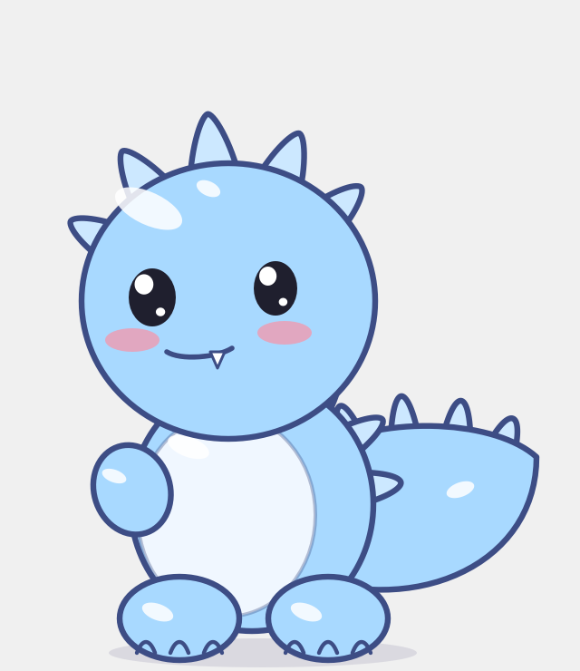

# DeskDragon

A little dino that lives on your Mac desktop. It wanders along the bottom of your screen, looks at
your cursor, and teaches you its own tricks through a speech bubble.

Swift + AppKit, no dependencies. The default dino is drawn in code with bezier paths; you can also
hand it any picture and it becomes the pet.



## Run

```sh
./make-app.sh          # builds DeskDragon.app
open DeskDragon.app
```

Or `swift run` for a dev build. There's no Dock icon: right-click the dino and choose Quit to close it.

## Tricks

The dino hints at tricks you haven't found yet, and stops once you do. Right-click it and open
**Tricks** to see which ones you've found.

- **Click** it: fire breath
- **Double-click** it: zoomies
- **Drag** it around and throw it
- **Hold the cursor on it**: pets
- **Drop a file on it**: snack (the file isn't touched)
- **Right-click** it: menu

It also blinks, turns to face you, and falls asleep if you ignore it for a while.

## Use your own picture

Save a picture of any creature as `pet.png` next to `make-app.sh` and relaunch, or right-click the
dino and pick **Use a picture…**. The background is removed automatically (macOS Vision), keeping
the largest subject. A picture pet does everything the drawn one does except blink and move its eyes.

## Layout

- `Sources/DeskDragon/DinoArt.swift` — the drawn dino, driven by a `Pose`
- `Sources/DeskDragon/ImageSprite.swift` — picture pets: background removal, fitting, hit testing
- `Sources/DeskDragon/PetBrain.swift` — state machine, physics, particles, tricks, speech
- `Sources/DeskDragon/PetWindow.swift` — transparent floating window, drawing, mouse and file drops
- `Sources/DeskDragon/main.swift` — app setup, the 60 Hz tick, click-through

Requires macOS 14 or later.
